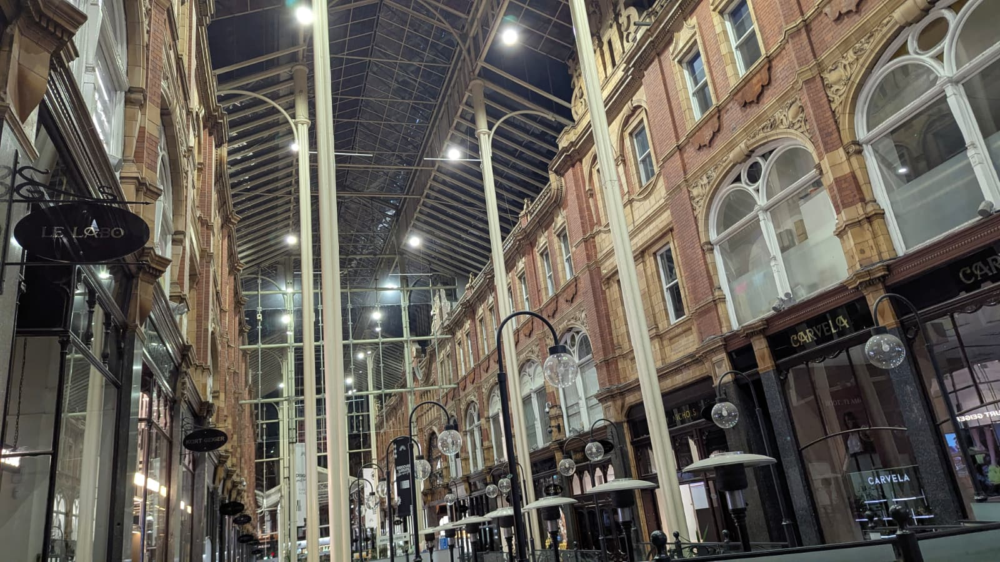

There is something mildly absurd about me writing about taking breaks. I am not particularly good at them.

In more than three decades of existence, I could probably count the genuine breaks I've taken. The rest have been pseudo-breaks at best. Time away from earning a living, perhaps, but not necessarily away from the things that make earning a living necessary.

And yet, I've increasingly come to appreciate what happens when we step away from our usual endeavours, even temporarily.

There is a certain clarity that comes with it. Things that previously seemed urgent become less so. Problems that occupied our minds for weeks begin to look different. Sometimes, the decision we had been struggling to make no longer seems particularly difficult.

But there is also the guilt that accompanies the decision to stop.

Am I resting, losing momentum, avoiding something, or quietly giving up? If I leave something alone for long enough, will I still want to return to it? And if circumstances force the break upon me, can I even call it a break?

I've been thinking about these questions, particularly the relationship between taking extended holidays and the important decisions we make in life.

Interestingly, the word _holiday_ comes from the Old English _hāligdæg_, meaning a holy day. Originally associated with religious observances, its meaning eventually expanded to include time away from ordinary labour.

I find that origin rather fascinating. The idea that certain days could be set apart from the usual demands of existence.

Now, I'm particularly interested in breaks that last longer than a weekend or the occasional two-week holiday. The kind where you step away from earning a living for months, perhaps even a year, without necessarily knowing what you're going to do with the time.

Something I've observed about people whose accomplishments we admire is that extended periods away from their usual endeavours sometimes appear in their stories before significant changes in their lives.

When I watched the Jobs movie, I became curious about Steve Jobs' journey to India.

In 1974, before Apple existed, Jobs travelled to India with his friend Daniel Kottke. He spent several months exploring spirituality, visiting ashrams and trying to make sense of questions that had little to do with building computers.

It wasn't a conventional holiday, but neither was it a professional undertaking.

Then there is Phil Knight.

In _Shoe Dog_, Knight recounts his journey around the world in 1962, visiting Japan, India and several other countries before Nike existed.

What makes his account especially interesting is that he already had the idea of importing Japanese running shoes before leaving America. His travels were partly an opportunity to explore that idea and partly an attempt to experience a world he knew relatively little about.

His father also helped finance the journey.

That last detail is important, and I'll come back to it.

Both men eventually went on to build extraordinary things. It is tempting to look at their travels and conclude that stepping away from conventional work somehow prepared them for what followed.

I've certainly been tempted to make that connection.

But perhaps we're giving these journeys importance because we already know how their stories ended.

If Jobs hadn't founded Apple, would his months in India have meant anything to us? If Knight hadn't built Nike, would his journey around the world be regarded as anything more than the adventure of a young man trying to find his place?

How many people have taken similar journeys, returned home, and simply continued with their lives?

And would that make their experiences any less valuable?

I don't know.

There is some evidence that time away from work can improve aspects of cognitive flexibility, but that doesn't necessarily explain why certain experiences appear to precede life-changing decisions.

It reminds me of something considerably more ordinary.

When we wake up after a good night's sleep, we often find ourselves better equipped to think through things that seemed difficult the previous evening.

What exactly changes?

And if a night's sleep can offer that kind of mental refreshment, what happens when we extend the distance between ourselves and our usual responsibilities?

Is there a threshold?

Would taking a nap every three hours improve our ability to think throughout the day? Or would our minds eventually adapt, making the supposed benefit less noticeable?

Perhaps an extended holiday offers something sleep alone cannot. The opportunity to experience life without constantly returning to the same obligations.

Or perhaps I'm confusing two fundamentally different things.

What I do find curious is that, whenever I manage to take a break from earning my keep in the committee of the human species, I tend to become more engaged with the things I enjoy doing for their own sake.

Running, writing, building software.

Things that could reasonably be described as work, except that I am not necessarily doing them because someone needs them done or because they must produce an economic outcome.

I'm doing them because I enjoy doing them.

It makes me wonder whether the clarity I associate with taking breaks comes from doing less or simply having greater freedom to decide what deserves my attention.

But this brings me back to the uncomfortable part of the whole observation.

The ability to step away from earning a living without worrying about the consequences is a luxury that isn't evenly distributed.

Someone might argue that everyone can afford a holiday suited to their financial circumstances.

And I wouldn't necessarily disagree.

But that isn't quite what I'm talking about.

I'm talking about the possibility of taking an entire year away from earning a living without spending that year worrying about what happens afterwards.

What happens to your employment? Will the job still exist? Will the skills you've spent years acquiring remain relevant in a world where technological change, particularly AI, is already making people question the future of their work?

What happens to the responsibilities that do not disappear simply because you've decided you need some time away?

One could argue that a year is excessive.

Why not three months? Six months? Or even two?

But the question remains.

How much of that time would genuinely belong to you if you spent it worrying about what awaits you when you return?

And what about someone whose break wasn't a choice at all?

Someone who lost their job, whose business failed, or whose circumstances simply made continuing impossible.

They might have an entire year away from work, but would they experience the clarity I've been describing?

There is a difference between having nothing to do and having the freedom to do nothing.

Perhaps that difference matters more than the duration of the break itself.

I'm also beginning to question my original assumption that vacations should lead to clarity or important decisions.

Why must a break produce something valuable before we consider it worthwhile?

The moment I describe extended holidays as a superpower for making better decisions, I've already found a way to turn them into another instrument of productivity.

Take time off, gain clarity, return with a better idea, make something extraordinary.

Even our attempts to escape the demands of work somehow end up being justified by what they might enable us to accomplish afterwards.

What if nothing extraordinary happens?

What if someone takes a year away and returns without a business idea, a new career, or some profound understanding of their existence?

Has that year been wasted?

I'm not entirely sure why we are so quick to measure time this way.

Perhaps it's because many of us have spent most of our lives learning that our time must be accounted for, that there must be something to show for it.

And perhaps that's also why taking a break comes with so much guilt.

As with most things I write about, I don't have a solution to offer.

I can only reflect on my own experiences, the lives I've observed, and the questions they leave me with.

Personally, I hope to someday have the luxury of taking at least a year away from earning a living.

Not necessarily to discover the next big idea, reinvent myself, or return as a more productive person.

Just to experience what it means to have that much time without having to worry about the state of my existence afterwards.

I look forward to that possibility, hopefully in the not-so-distant future.

Although, there is one thing I haven't quite figured out.

After spending so much of my life learning how to keep going, would I even know what to do with the freedom to stop?

Here’s a picture I took while i was away at Leeds over the weekend after work.
