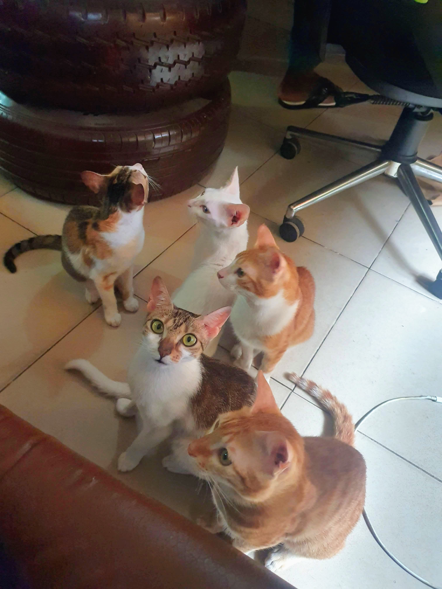

*Reigniting it, totally out of your control, btw.*

Sparks and sparkles… what even is that?

You find your spark when you’re usually not looking. And it often comes after you’ve gone through some form of turbulence that lingered longer than you imagined it would.

> There’s a verse in the Quran, in Surah Ash-Sharh, 94:6: “Inna ma‘al ‘usri yusra.” Indeed, with hardship comes ease.

Sometimes these hardships are visible to the world. Often, they’re solely internal, and the closest person to you might have zero clue.

Think about someone who carries a considerable part of their family’s responsibilities. The person making sure things work, playing the parental role, looking after everyone, remembering what needs to be done and somehow finding a way to do it.

They come home and play with the kids. They’re bubbly, making jokes, asking everyone about their day. There’s food to sort out, something in the house needs fixing, someone needs help with something that apparently cannot wait until tomorrow.

And they’re there for all of it.

Meanwhile, work has become a source of pressure they don’t quite know how to explain. The workload keeps growing. Even away from it, part of their mind is occupied by what remains unfinished and what tomorrow will demand of them.

But the children still get a playful parent. Their partner still gets someone who participates. At work, things still get delivered.

From the outside, what exactly has changed?

Perhaps very little. Which makes it quite difficult for anyone to notice that something has.

And I don’t think the laughter necessarily has to be fake. You can enjoy playing with your children and still carry something painful that the enjoyment doesn’t resolve. Being lively around people you love doesn’t mean everything within you is equally alive.

You’re still doing the things. Some of them quite well, actually. Yet you can feel a difference that you cannot point to in any of the things you’ve done.

Then, at some point, you say, “I have my spark back.”

What do we mean when we say that?

For me personally, I think we don’t lose our spark and find it again. I mean, we do, but perhaps not in the sense that it left.

Think about it. How often do we lose “this spark” and find it again and again and again?

Did we ever lose it in the first place? Where exactly does it go while we continue being a parent, a partner, a friend, an employee and all the other things we’ve agreed to be?

Could it be that what we sometimes describe as losing our spark is a lack of the almost obsessive discipline required to follow through on a promise we’ve made to ourselves?

We wanted to accomplish something. We were excited about it. Then the excitement wore off, and continuing became considerably less interesting than starting.

Motivation is a great feeling, but one that evaporates as time goes by. Relying on it to keep going is like expecting the wind to blow in your direction for the entire journey.

There are things you simply have to continue doing after the feeling that started them has disappeared. I believe that.

But hold on… the person I described earlier hasn’t stopped doing anything.

They’re following through every day. People depend on them, and they keep showing up. If discipline were the entire explanation, surely they would have enough of it by now to feel like themselves.

So why did I reach for discipline?

It started with a question about something we feel within ourselves and somehow arrived at whether we’re doing enough. Interesting.

Perhaps I’m mixing together experiences that happen to share the same expression.

Losing interest in a particular ambition. Being worn down by responsibilities. Finding very little enjoyable. Being unable to begin something you still care about. We might describe all of these as losing our spark, but I’m not sure they’re asking the same thing of us.

And if we don’t know which one we mean, how do we know what we’re trying to reignite?

For the person carrying their family and their workload, another promise to become more disciplined might simply become another thing to carry.

There’s also something curious about how we notice its return.

Sometimes you realise you’ve spent an hour doing something without having to negotiate with yourself first. You become curious about a thing that has no immediate relevance to any of your responsibilities. You look forward to a day without first checking what you’ll accomplish in it.

Nothing particularly remarkable to report. You might even have got less done.

Would you still say your spark was back?

Would the people around you recognize it if its return meant you were less available to do everything they had become accustomed to you doing?

That question makes the whole thing slightly less comfortable.

Because being dependable can become such a familiar part of how people experience you that there’s very little reason for them to question what it takes. Things are working. You’re laughing. You said you were fine.

And perhaps you don’t know what else to say. Explaining it would require understanding it first, and you’ve barely had time to sit with it yourself.

I’m beginning to think there are limits to what we can demand back from ourselves through effort alone. We can make decisions, change what is possible to change, keep certain promises. But I don’t know that we can instruct ourselves to feel interested, light or hopeful on a particular date.

The spark has refused the calendar invite. Very unprofessional.

Still, I’m not entirely convinced it disappeared.

Perhaps what changed was how much of our attention and energy was already spoken for before we had a chance to decide what to do with it. Perhaps that explains some of it. It certainly doesn’t explain every season in which a person feels far away from themselves.

I wonder how much of that we can deliberately bring about.

Because if I knew exactly what brought it back, surely I would know what to do the next time it disappeared. Yet somehow, each time, I’m back here trying to understand something I thought I’d already figured out.

And there’s something about the word “back” too.

It assumes I know the version of myself I’m trying to return to. That the person before the turbulence is still the person I want to be after it.

_Here’s a picture of furry friends back in the days… the year was 2020_

*My housemates… L-R: Chika, Esosa, Nairobi, Tyr, BumbleBee.*

*Originally published as [Sparks & Sparkles...](https://wales-note.beehiiv.com/p/sparks-sparkles) on Notes by Wale.*
