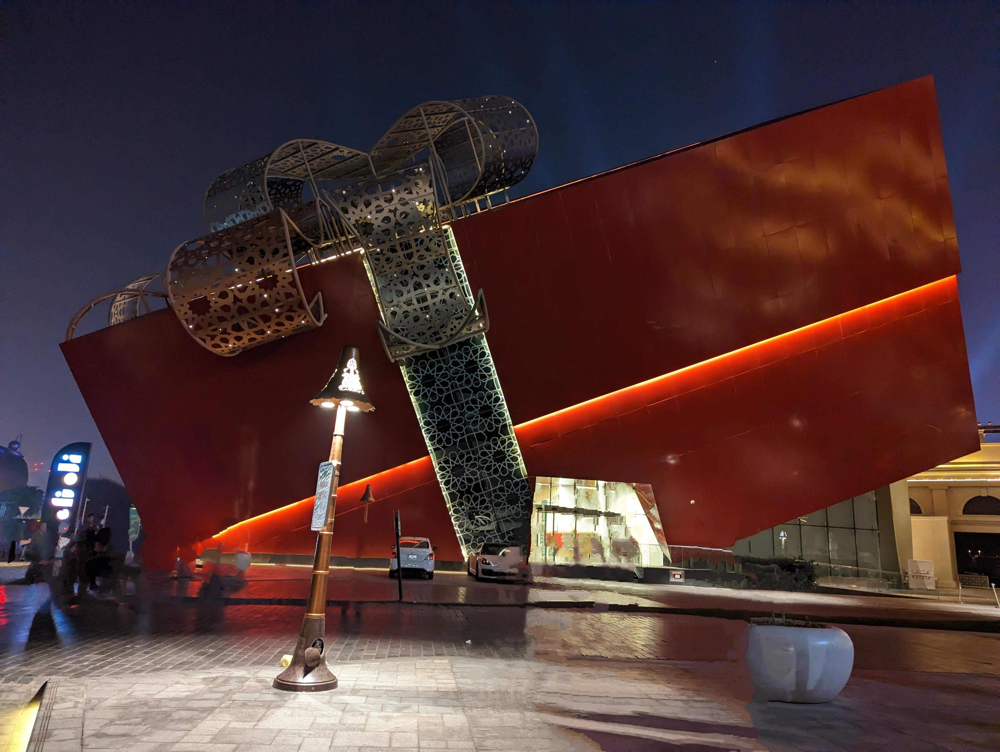

Lets talk about work… Not necessarily the work we're paid to do, but the work we would do if nobody paid us. The work that occupies our minds long after we've closed our laptops, left our offices, or finished whatever it is we do to earn a living.

The visible and invisible work. The passion projects. The things we once wanted to make, discover, build, or simply spend our lives doing.

And perhaps more importantly, the things that have disappeared entirely because life got in the way.

Thinking about the relationship between creativity and the means to pursue it.

For most people, indulging in a passion project requires funding. And funding, despite what the media and the more optimistic proponents of capitalism would have us believe, isn't something one simply comes by.

Someone has to pay for it.

Sometimes that someone is you, through savings from a job you may or may not particularly enjoy. Sometimes it's an institution, a wealthy individual, a government, or an organization that sees enough potential value in what you're doing to justify supporting it.

I usually use examples like; for you to indulge in passion projects, it has to be funded. The fact that someone or some institution has to fund something you care about already defeats the purpose. If the funding gets pulled what happens to your project?

Does the work cease to be important? Does your curiosity suddenly become less valid? Or does it simply mean that whatever you were trying to bring into the world no longer satisfies someone else's economic interests?

This is a complex topic with varying degrees of tangents in human evolution but for the sake of this short essay, lets talk about… ***How much human creativity have we lost by making the ability to create dependent on the ability to pay for it?***

Consider the Wright brothers.

Two men who became obsessed with the possibility of human flight. They weren't employees of some aviation conglomerate commissioned to invent an aeroplane. They ran a bicycle business, and the income from that business helped finance their experiments.

Their curiosity preceded the commercial opportunity.

One could say something similar about countless artists, inventors, musicians, and thinkers throughout history. Although their circumstances differed considerably, many pursued ideas long before those ideas had any obvious commercial value.

Picasso didn't need someone to establish a market opportunity for Cubism before experimenting with the form. That doesn't mean he existed outside the economics of his time, or that patronage and money played no role in his career. They certainly did.

But there is an important difference between creating something because you believe it should exist and creating something because somebody has agreed to pay for it.

And increasingly, the former appears to require the latter.

### The strange business of earning a living

Humans without "means" find it increasingly difficult to exist as humans.

That sentence is quite disturbing!

If someone isn't paying you "wage/salary" or living off "inheritance", you merely can't live, its practically impossible.

Think about it.

If all you truly wanted to do was paint, or play musical instruments, or build sculptures or anything that you fell in love with as a kid and there's something about putting colours on a canvas that makes being alive worthwhile to you.

Not become a famous painter. Not build a personal brand around your paintings. Not sell courses teaching people how to paint, or create content documenting your artistic journey.

Just paint.

But now you're a grown human specie and can't exist without "***earning a living***" which means unless your service is valued by someone, organizations, you're doomed to not earn your keep as a member at the top of the food chain.

You need somewhere to live. You need food, electricity, healthcare, clothing, and perhaps a few other things that make existence bearable.

None of those things are particularly interested in your paintings.

Your landlord certainly isn't.

How ironic don't you think?

So you must find something people are willing to pay you for. And if painting isn't one of those things, you must spend a considerable part of your life doing something else.

Your passion becomes something you indulge in after you've finished doing what society considers economically useful.

If you're lucky, you have some energy left for it.

If you're very lucky, you make enough money to buy back some of your time.

And if you're extraordinarily lucky, somebody eventually decides your paintings are worth paying for.

We've somehow arrived at a point where being human requires earning the financial means to remain human.

We've evolved so much that we have to earn to be able to stay on earth, the alternative you would ask? Well, be incarcerated or in an asylum as "we've" agreed we should have no true freedom of existence except you've amassed a great amount of human created material wealth.

We're supposedly the most intelligent species on the planet. We've built machines that can traverse continents, instruments that can observe galaxies, and computers capable of performing extraordinary intellectual tasks.

> Yet we still haven't figured out how to give the average human being the freedom to pursue something simply because they find it meaningful.

We have become exceptionally good at improving the tools of human existence without necessarily improving the experience of being human.

### The promise of freedom

Now, there's another interesting dimension to this.

Wealth.

Or more precisely, the promise of wealth.

We've built an entire culture around the idea that financial freedom is available to anyone willing to work hard enough, take enough risks, or make enough sacrifices.

Work now so you can live later.

Build wealth so you can pursue your passions.

Sacrifice your twenties so you can enjoy your forties.

Sacrifice your forties so you can retire comfortably in your sixties.

There's always another milestone between you and the life you actually want to live.

And while some people do manage to accumulate enough wealth to escape the necessity of working, **that possibility is far from evenly distributed.**

The circumstances of one's birth, access to education, geography, inherited wealth, social connections, health, and plain luck all influence how realistic that promise is.

Yet we continue to sell the possibility as though it were simply a matter of individual determination.

It's a rather clever arrangement, isn't it?

**We sell people the dream of eventually escaping the very conditions under which they must spend most of their lives.**

And the price of that dream is often more of their lives.

I don't think there's anything inherently wrong with wanting wealth. Nor do I think being paid for work somehow makes that work less meaningful.

Its deeper than that… the cost of being human is so high now more than it has ever been.

The painter must first become financially stable enough to paint.

The musician must first earn enough to afford the time to practice.

The inventor must somehow convince someone that an idea nobody has ever seen is worth financing.

And the thinker? Well, they'd better find a way to monetize those thoughts… Loool.

### The work we'll never see

I wonder how many extraordinary things have never existed because the people capable of creating them were too busy earning a living.

How many remarkable musicians never picked up an instrument again after childhood?

How many potential breakthroughs died quietly in the minds of people who couldn't afford to experiment?

How many artists abandoned their craft, not because they stopped loving it, but because the demands of existence left them with neither the time nor the energy?

We tend to celebrate the extraordinary individuals who managed to overcome these circumstances.

The stories are inspiring, certainly.

But they're also convenient.

Because for every person who makes it through, there are countless others whose work we'll never encounter.

Not because they lacked talent, ambition, or curiosity.

But because curiosity doesn't pay the rent.

And perhaps that's the part of human progress we don't discuss enough.

### What exactly have we been progressing towards?

Human beings have always had to work to survive. Our ancestors weren't exactly spending their afternoons painting landscapes while someone else gathered food.

And modern society has made possible extraordinary freedoms that previous generations couldn't have imagined.

But surely the purpose of progress cannot simply be to create more sophisticated ways of earning the right to exist.

At some point, shouldn't advancement translate into more freedom to be human?

Not necessarily freedom from all responsibility or contribution, but freedom to contribute in ways that aren't immediately reducible to economic value.

- Freedom to experiment without an investor.
- To make music without an audience.
- To study something without considering its employment prospects.
- To build something because you think it would be interesting to see whether it works.
- To be curious without having to explain how that curiosity might eventually generate revenue.

Maybe the real tragedy isn't that we have to work.

Maybe it's that we've become so accustomed to organizing our lives around earning a living that we've stopped questioning how much living gets sacrificed in the process.

And somewhere along the way, the things we once wanted to do simply because we loved doing them became things we hoped to afford someday.

**The cost of being human has become extraordinarily high.**

Not just in money.

But in all the things we might have been, had we been free to find out and express.

*Originally published on [Notes by Wale](https://wales-note.beehiiv.com/p/the-cost-of-being-human).*
